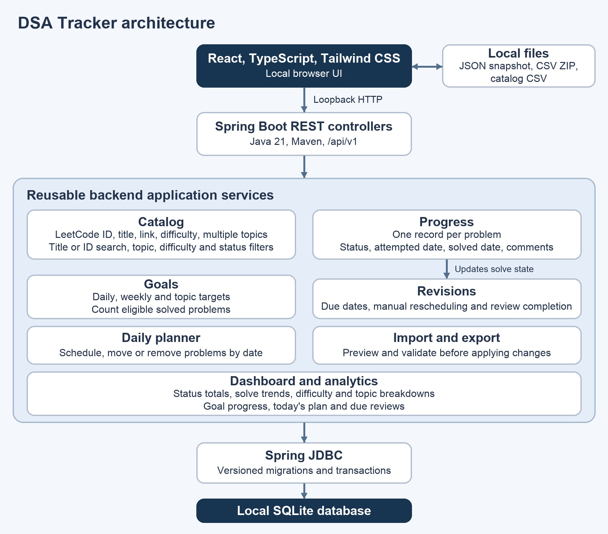

# DSA Tracker Architecture

## Application and feature flow

[Editable Mermaid source](diagrams/architecture-flow.mmd)

The dashboard reads current problem and progress records, goal results, the day's planner entries, and due reviews. Goal calculations use solved dates and topic membership. The optional [local MCP adapter](MCP_INTEGRATION.md) exposes a diagnostic tool and read-only catalog, reporting, planner, goal, and revision tools through the shared application services. Progress, planner, goal, and revision write tools require a separate opt-in and reuse the same application transactions as REST.

## Runtime and stack

Run a React and TypeScript frontend styled with Tailwind CSS against a local Java 21 Spring Boot backend built with Maven. The backend owns an on-disk SQLite database at a configurable path. Bind the backend to loopback by default. Serve the built frontend from Spring Boot for daily use and use a frontend development proxy for API requests during development. Bundle frontend assets locally so ordinary use needs no remote fonts, scripts, or APIs.

LeetCode discovery is an on-demand MCP integration with a public GraphQL endpoint. It compares remote metadata with local problem IDs, and its preview snapshots expire in memory. Discovery leaves SQLite untouched and uses the network only to fetch metadata. The opt-in import tool can save selected candidates from an unexpired preview through the catalog service, without another network request.

Study recommendations query the local catalog and planner and keep bounded, expiring proposals in memory. A separate authenticated operator endpoint records approval decisions. An approved proposal can be committed with its result in one SQLite transaction.

The browser stores transient UI state such as pending edits and selected filters. SQLite is the authoritative store for application data. Resolve calendar dates in one configurable application time zone, defaulting to the system zone. Pass an injectable clock to services that need to determine today.

## Backend boundaries

- **REST controllers** parse requests, map transport DTOs and validation errors, and delegate to application services. Expose a versioned API under `/api/v1` for problems, progress, goals, planner entries, revisions, dashboard queries, and file exchange.
- **Application services** own problem and progress changes, goal calculations, planner operations, revision scheduling, dashboard queries, and import/export orchestration. Define service inputs and results independently of HTTP requests and responses. Future adapters can invoke these same use cases.
- **Persistence** uses Spring JDBC and parameterized SQL. Manage schema changes through ordered, versioned SQL migrations. Enable SQLite foreign keys on every connection. Keep write transactions short and make cross-record changes atomic, including problem creation with initial progress, solving with revision scheduling, and imports.

Validate individual fields at the application boundary and enforce domain rules in application services. Use database uniqueness, foreign keys, and checks for invariants that SQLite can enforce. Return structured validation errors that the frontend can associate with fields or import rows.

## Data model

- **Problem** stores an internal ID, unique LeetCode ID, title, link, and difficulty. A **Topic** stores a display name and a case-insensitive unique name. A junction table maps problems to topics.
- **Progress** uses the problem ID as its primary key. It stores status, attempted date, solved date, and comments. Create exactly one row with each problem.
- **Goal** stores a type, inclusive period start and end, target count, and optional topic and difficulty restrictions. Validate period boundaries according to goal type.
- **Planner entry** references a problem and stores its scheduled date. The problem and date pair is unique.
- **Revision schedule** uses the problem ID as its primary key and stores the next due date, the optional latest reviewed date, and whether the schedule still follows the original solved date. This lets date corrections update the initial schedule while preserving manual and reviewed schedules.

Store date-only values as ISO `YYYY-MM-DD` text and represent them as `LocalDate` in Java. Use transactions to keep dependent rows consistent when progress changes or a full restore replaces the dataset. Index the columns used to query by date and topic. Derive goal counts and dashboard summaries from current records without a separate analytics store.

The Goals page loads its problem list on expansion. `GET /api/v1/goals/{id}/problems` (also available under `/api/goals`) accepts zero-based `page`, `size` up to 100, `filter` (`ALL`, `COUNTED`, `OUTSIDE`, `ATTEMPTED`, `NOT_STARTED`), and `sort` (`LEETCODE_ID`, `DIFFICULTY`, `STATUS`). It returns `items`, `page`, `size`, `totalPages`, the filtered `totalItems`, the catalog `totalMatching`, and the period `counted` total. Problem rows include topics, progress dates, and flags for counted and outside-period solves. The repository shares the catalog restrictions and inclusive SOLVED-date rule with goal progress, sorts ties by LeetCode ID, and loads the topics for a page in one query.

## Import and export contracts

- Use one logical, versioned snapshot for complete exports. JSON represents it directly. The CSV archive contains separate CSV files for problems, topics, problem-topic links, progress, goals, planner entries, and revisions, plus a format version file.
- Use portable keys within a snapshot to resolve references. Use LeetCode IDs for problem references and preserve topic identities when rebuilding goal and problem associations. Preserve comments, including line breaks and quotes, through UTF-8 serialization and CSV quoting.
- Parse and validate complete files before applying changes. Preview counts, conflicts, and errors such as duplicate keys, invalid progress dates, and missing references. Revalidate the submitted file when applying it. Replace all tracker data together in one transaction for a confirmed full restore.
- Define the standalone catalog CSV separately from the full snapshot. Use a header row and a documented representation for multiple topics. Upsert catalog fields by LeetCode ID, initialize progress for new problems, and apply the import as a single transaction.

## Local MCP adapter

Spring Boot serves Streamable HTTP at `/mcp` when enabled. MCP tools, resources, and prompts adapt existing services and expose structured output. The endpoint stays loopback-only, including when reached through the Docker frontend on its loopback port. MCP write registrations require a separate opt-in. Batch planner commits require an operator-approved immutable snapshot and use one SQLite transaction. Direct MCP planner writes require a short-lived, single-use operator grant bound to the exact action. The operator approval credential stays outside the MCP registry.

In the unified profile, `query_tracker` validates the domain and JSON fields against typed request records. The application query service delegates to catalog, planning, revision, and reporting services. Those services use JPA Specifications with database pagination, pageable JPQL, or bound SQLite queries as appropriate. They map records to compact MCP DTOs. The query path makes no network requests and has no write operations. Catalog and planning routes continue to share their existing domain rules with REST.
