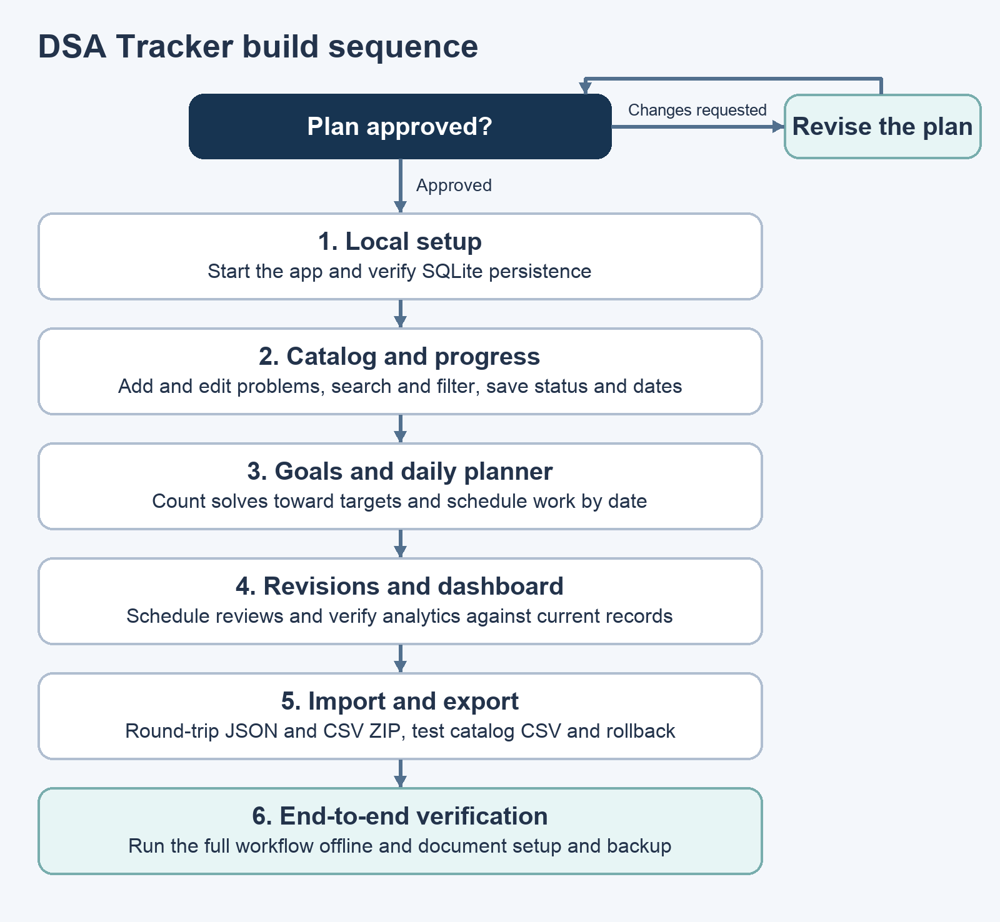

# DSA Tracker Implementation Plan

**Status:** Proposed for review. Application implementation begins after the user approves this plan.

## Build sequence

[Editable Mermaid source](diagrams/implementation-flow.mmd)

Verify the current phase using the checks below before moving to the next one.

## 1. Set up the local application

- Scaffold the React, TypeScript, and Tailwind CSS frontend and the Java 21 Spring Boot Maven backend.
- Configure local development, loopback serving, the SQLite path, migrations, connection settings, and the application time zone.
- Verify that the frontend can reach the backend and that application data survives a restart using the same database. Verify built assets load with internet access disabled.

## 2. Build the catalog and progress workflows

- Add schema migrations and services for problems, topics, and progress. Wire the services into REST endpoints and the frontend catalog.
- Build problem creation and editing, status and date updates, comments, title and ID search, and combined filters.
- Verify unique LeetCode IDs, topic matching, date defaults and validation, direct solves, status reversals, comment preservation, and persistence.

## 3. Add goals and the daily planner

- Implement daily, weekly, and topic goals. Display progress calculated from current solved dates and problem topics.
- Implement scheduling, moving, and removing problems through a date-based planner.
- Verify inclusive date boundaries, Monday week starts, topic counting, duplicate planner prevention, and status visibility on scheduled entries.

## 4. Add revisions and the dashboard

- Add revision scheduling to the same operation that sets or changes solved progress. Build views and actions for upcoming and due revisions.
- Build dashboard queries and display status totals, difficulty and topic counts, solved trends, goal progress, today's scheduled problems, and due revisions.
- Verify due-date boundaries, automatic and manual scheduling, completed reviews, solved-date corrections, reopened problems, and dashboard counts after edits.

## 5. Add file exchange

- Document the JSON and CSV formats. Build full snapshot export and restore for both formats, plus standalone catalog CSV import.
- Add import previews, actionable errors, and explicit confirmation for a full restore.
- Verify full round trips into a fresh database, including multi-topic problems, nullable dates, and multiline comments. Verify that broken references and duplicate keys are reported, failed imports roll back, and reimporting a catalog preserves existing progress.

## 6. Verify the complete local workflow

- Exercise the main workflow from startup and catalog entry through goal completion, planning, revision, export, and restore with internet access disabled.
- Run the backend and frontend checks. Use a separate temporary database for automated and manual verification.
- Add local setup, build, run, and data backup instructions. Include the database location and explain how catalog imports and full restores affect existing data.

## Decisions for review

- Use a single local profile with one configurable time zone. Daily and weekly goals apply to explicit periods, and topic goals use a user-selected date range.
- Derive goals and trends from current progress. Editing a solved date, reopening a problem, or changing its topics can revise earlier totals. Reopening clears the solved date and active revision schedule.
- Use a seven-day revision interval for the first revision and for subsequent reviews, with manual due-date overrides.
- Use a CSV archive for complete snapshots and a standalone CSV for catalog import. A complete restore replaces existing data after confirmation. Catalog import updates metadata by LeetCode ID while preserving existing practice records.
